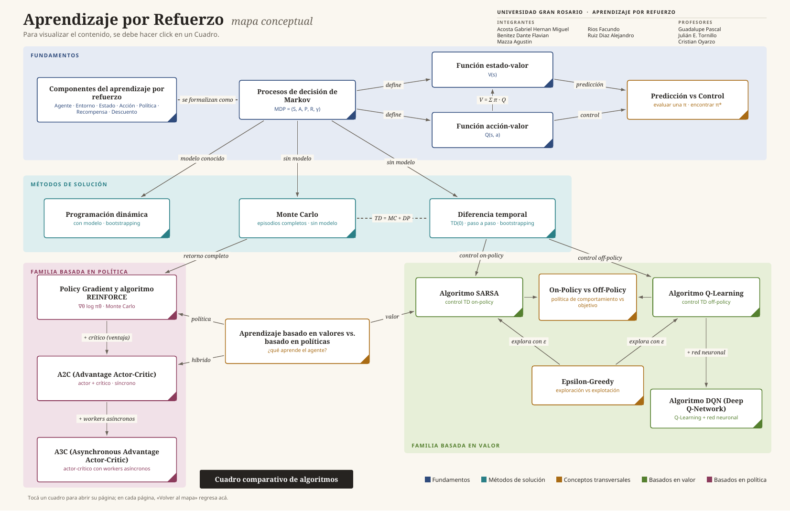
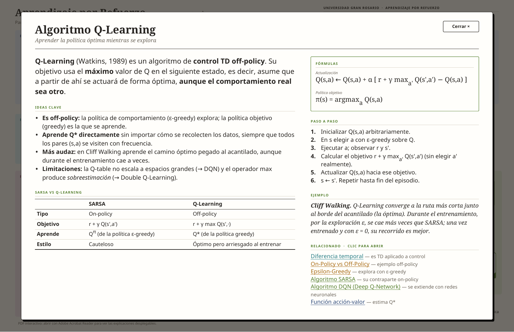

# Aprendizaje por Refuerzo · Mapa conceptual interactivo

Trabajo de la materia **Aprendizaje por Refuerzo** · **Universidad Gran Rosario**.

Mapa conceptual de los 17 temas de la consigna (componentes del RL, MDP, funciones de valor,
programación dinámica, Monte Carlo, diferencia temporal, SARSA, Q-Learning, ε-greedy, DQN,
Policy Gradient/REINFORCE, A2C y A3C), con una explicación de cada concepto y un cuadro
comparativo de algoritmos. Se entrega como **PDF interactivo**: al hacer clic en un cuadro del mapa se
abre su explicación.



## Integrantes

- Acosta Gabriel Hernan Miguel
- Benitez Dante Flavian
- Mazza Agustin
- Rios Facundo
- Ruiz Diaz Alejandro

## Profesores

Guadalupe Pascal · Julián E. Tornillo · Cristian Oyarzo

## Qué PDF usar

Hay dos versiones, con el mismo contenido y el mismo diseño. Se diferencian en cómo se abre la explicación:

| Archivo | Cómo funciona | Dónde funciona |
|---|---|---|
| [`pdf/Mapa_Conceptual_Aprendizaje_por_Refuerzo_PAGINAS.pdf`](pdf/Mapa_Conceptual_Aprendizaje_por_Refuerzo_PAGINAS.pdf) | Cada cuadro lleva a su propia página; «← Volver al mapa» regresa. | **Cualquier visor**, incluido el celular. **Recomendado para entregar.** |
| [`pdf/Mapa_Conceptual_Aprendizaje_por_Refuerzo.pdf`](pdf/Mapa_Conceptual_Aprendizaje_por_Refuerzo.pdf) | Una sola página: el contenido se despliega sobre el mapa y el resto queda oculto. | Adobe Acrobat (escritorio) y Firefox. **No** funciona en visores de celular ni, en general, en Chrome/Edge. |



> **Cómo está hecho el PDF desplegable.** Cada concepto es una *capa* (grupo de contenido opcional) del PDF,
> apagada al abrir el archivo. Cada cuadro tiene una acción estándar `SetOCGState` que enciende su capa y
> apaga las demás; no usa JavaScript. Los visores que no implementan esa acción simplemente no reaccionan,
> por eso existe la versión de páginas.
> Probado con clics reales en Firefox (PDF.js). Pendiente de probar en Acrobat.

## Estructura del repositorio

```
.
├── pdf/        PDFs generados (entregables)
├── docs/       Contenido y estructura en texto (Markdown) + imágenes del README
├── src/
│   ├── contenido.py            Textos, fórmulas, tablas y posición de cada cuadro (se edita acá)
│   ├── build_interactivo.py    Genera el PDF desplegable (capas)
│   ├── build_paginas.py        Genera el PDF de páginas (reutiliza el diseño del anterior)
│   ├── exportar_contenido.py   Exporta estructura y contenido a docs/*.md
│   └── verificar_enlaces.py    Comprueba que los enlaces de los PDF lleven a donde deben
├── fuentes/    Noto Sans, Noto Serif y DejaVu Sans (+ licencias en fuentes/licencias)
└── requirements.txt
```

## Estructura del mapa

- **Fundamentos:** Componentes del RL → MDP → función estado-valor V(s) y acción-valor Q(s,a) → Predicción vs Control.
- **Métodos de solución:** Programación dinámica (con modelo) · Monte Carlo y Diferencia temporal (sin modelo).
- **Conceptos transversales:** Valores vs. políticas · On-policy vs. Off-policy · ε-greedy.
- **Familia basada en valor:** SARSA (on-policy) · Q-Learning (off-policy) → DQN.
- **Familia basada en política:** Policy Gradient/REINFORCE → A2C → A3C.

La lista completa de relaciones (con sus rótulos) y el texto de cada concepto están en
[`docs/Contenido_y_estructura_mapa_conceptual.md`](docs/Contenido_y_estructura_mapa_conceptual.md).

## Regenerar los PDF

Requiere Python 3 (probado con 3.13).

```bash
python -m venv .venv
source .venv/bin/activate          # en Windows: .venv\Scripts\activate
pip install -r requirements.txt

python src/build_interactivo.py    # → pdf/Mapa_Conceptual_Aprendizaje_por_Refuerzo.pdf
python src/build_paginas.py        # → pdf/Mapa_Conceptual_Aprendizaje_por_Refuerzo_PAGINAS.pdf
python src/exportar_contenido.py   # → docs/Contenido_y_estructura_mapa_conceptual.md
python src/verificar_enlaces.py    # comprobación de enlaces (debe terminar con "Todo correcto.")
```

Los scripts se pueden ejecutar desde cualquier carpeta. Las fuentes van incluidas en `fuentes/`, así que no
hay que instalar nada más.

### Cambiar textos, nombres o el mapa

- **Explicaciones, fórmulas, ejemplos, tablas, posición de los cuadros:** `src/contenido.py`.
  Marcado permitido en los textos: `<b>`, `<i>`, `<sub>`, `<super>`, `<br/>`.
- **Integrantes y profesores:** listas `INTEGRANTES` y `PROFESORES` al inicio de `src/build_interactivo.py`.
- **Flechas del mapa y sus rótulos:** lista `EDGES` en `src/build_interactivo.py`.
- Para revisar un panel sin abrir el PDF: `OPEN=qlearn python src/build_interactivo.py prueba.pdf` deja esa capa abierta
  (los archivos `prueba*.pdf` están ignorados por git).

Después de editar, volver a ejecutar los scripts de arriba.

## Fuentes tipográficas

Se incluyen **Noto Sans** y **Noto Serif** (SIL Open Font License 1.1) y **DejaVu Sans** (licencia Bitstream Vera/DejaVu).
Los avisos de copyright están en [`fuentes/licencias/`](fuentes/licencias).
